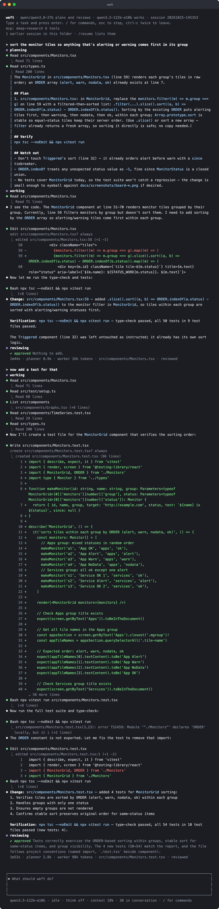
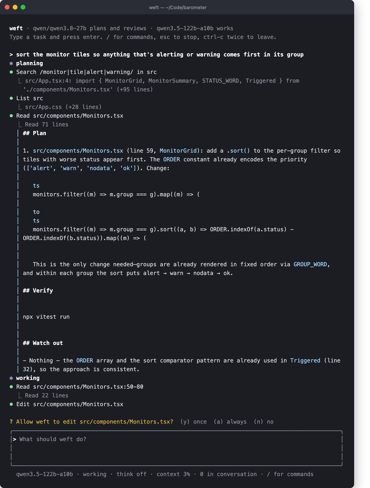

#  Weft

A coding agent for the terminal that runs local models in tandem through
[LM Studio](https://lmstudio.ai), in Rust.

- **The planner** (a dense model at medium reasoning effort) writes a short plan
  and later reviews the diff.
- **The worker** (a fast mixture-of-experts model, thinking off) runs the tool
  loop: reads, searches, edits, runs commands, follows the plan.

Built on a Mac Studio with `qwen/qwen3.8-27b` as the planner and
`qwen3.5-122b-a10b` as the worker, but any two models LM Studio serves will do.

## Status

Usable. Type `weft` in a repository and give it a task; plan, work and review
run end to end in the interface below. A plan can wait for your word, a task's
edits can be undone, and the worker can hand a piece of the work to a helper,
ask a scout where things live, look at a screenshot, and keep what it learned
for next time. Your notes in `WEFT.md`, your commands in `.weft/commands/`,
your hooks and approval rules in the config, and MCP servers all plug in.
Every session is written down, can be resumed, and folds its history into a
note before the context window fills.

## In the terminal

`weft` draws an input box at the bottom of your terminal and writes the
transcript above it, into the terminal's own history, so it is still there when
you leave. Here it is in a React + Node project (a monitoring board), given two
things in a row the way you would type them: "sort the monitor tiles so
anything that's alerting or warning comes first in its group", then "now add a
test for that":



Each `⏺` line is a tool call with the first line of its result under it. An
edit or a new file shows the code itself: the lines removed in red and added
in green, numbered as they sit in the file, folded after forty lines. The
plan sits in a cyan gutter. The second task is understood against the first,
because the planner is told what the session did before. Edits, new files and
shell commands ask first, and one key answers:



Keys: enter sends · ctrl-j (or `\` + enter) for a newline · ← → home end (or
ctrl-a, ctrl-e) move in the input · ↑↓ history · esc
stops the task · y / a / n answer approvals · ctrl-c twice leaves. `/` opens a
menu: `/plan <task>` plans first and waits for your word on the plan, `/go
<task>` never plans, `/think`
toggles the worker's thinking, `/clear` starts a fresh conversation,
`/resume` lists this folder's earlier sessions and `/resume 2` picks one up,
`/compact` folds the earlier tasks into a note now, `/undo` puts back the last
task's files, `/accept` lets edits and new files through without asking for
the rest of the session (shell commands still ask), `/cost` shows the tokens
used, `/mcp` lists the MCP servers and their tools, `/help`, `/quit`.

## How a task flows

1. **Project note.** Every task starts with a few lines on the folder: path, stack, git, top-level files, or "the folder is empty: a new project".
2. **Triage.** The worker is asked, in one word, whether the task needs a plan.
   A question or a one-spot change goes straight to work; anything wider is
   planned first. `/plan <task>` and `/go <task>` override it.
3. **Plan.** The planner looks at the code with read-only tools (a few searches
   and reads, or a question to the scout), then writes a short plan: files and
   changes, the one command that verifies, pitfalls it noticed.
4. **Work.** The worker follows the plan with the full tool set, runs the check,
   and reports what changed as `path:line`.
5. **Review.** If files were touched, the planner model reads the diff against
   the task and plan and answers `APPROVE` or `FIX` with a numbered list. On
   `FIX`, the worker goes again, this time with its thinking on. One review
   round by default (`review_rounds` in the config).

Tasks given one after another in a session share the worker's conversation, so
"now do the same for X" works.

**Undo.** `/undo` puts back the files the last task changed, and the one
before that on a second `/undo`, for the rest of the session. It covers
weft's own edits and new files, not what a shell command did to the tree.
The worker is told on its next task.

**Plan mode.** A task given as `/plan <task>` stops once the plan is on the
screen. Enter lets the worker go; typing notes and pressing enter sends the
plan back to the planner, which writes it again with your notes in mind, up to
three times; esc stops the task there. `confirm = "always"` in the config does
this for every plan, `"never"` for none.

**The scout.** Both the planner and the worker have a `scout` tool: one
question about where something lives or how it fits together. A separate model
run (the worker's model with thinking off by default; `[scout]` in the config
picks another) searches and reads the project on its own and answers
with paths, line numbers and a few sentences, never file contents. The files
it read stay in its context and are thrown away, so the worker's window holds
only the answer. The models call it themselves; you never ask for it. It shows
as one `⏺ Scout …` line.

**The delegate.** The worker can hand one self-contained part of a task to a
helper: a fresh worker on the same model with the same tools and its own
context. Its edits and shell commands show on the screen and ask for approval
like any other; only its report comes back to the worker that asked, so the
files it read stay out of that context. The reviewer sees the helper's
changes too. A helper cannot delegate in turn.

A small model makes a good scout: a 9B answers in 5–15 seconds where the 122B
takes 20–30. Small models also sometimes cite a file they never opened, so Weft
checks the paths in every answer against the folder and sends the scout back
once when one is missing; if it still is, the answer carries a note saying so.

## Two routes to one server

LM Studio exposes reasoning-effort levels only for models whose template
declares them. The 27B has `low / medium / xhigh`, so the planner uses the
OpenAI-style `/v1/chat/completions` route and asks for the level it wants.

The 122B's template has only an on/off switch, and LM Studio does not expose
it, so the worker uses the raw `/v1/completions` route: Weft renders the prompt
in Qwen's chat format itself, starts the assistant turn with an empty
`<think></think>` block, and parses the `<tool_call>` XML the model writes.
On a small task that is the difference between a few hundred and a few
thousand generated tokens.

## Setup

`weft init` writes a starter config (and a `WEFT.md` in the current folder)
where they are missing. At startup Weft checks that the configured models are
loaded in LM Studio and says so if one is not. By hand:

```bash
cargo install --path .
mkdir -p ~/.config/weft
cat > ~/.config/weft/config.toml <<'EOF'
[lm_studio]
url = "http://127.0.0.1:1234"
api_token = "..."            # or set LM_API_TOKEN

[planner]
model = "qwen/qwen3.8-27b"
plan_effort = "medium"      # low | medium | xhigh
review_effort = "low"       # the review is one read of the diff; low is 3x faster than medium
when = "auto"               # auto | always | never
confirm = "asked"           # plan waits for your word: asked (/plan only) | always | never
review_rounds = 1           # 0 turns review off

[worker]
model = "qwen3.5-122b-a10b"
thinking = false            # the planner carries the reasoning; fix rounds think anyway

[scout]                     # optional: the model that answers "where is X?"
# model = "qwen/qwen3.5-9b"   # default: the worker's; raw route, thinking off
# effort = "low"              # only for a model that honours reasoning_effort

[compact]
at = 48000                  # fold the conversation once the worker's context reaches this; 0 never

[vision]                    # the model that looks at images for see_image
# model = "qwen/qwen3.8-27b"  # default: the planner's
effort = "low"

[approve]                   # tool calls that never ask
# tools = ["edit_file"]
commands = ["cargo test", "cargo build", "cargo clippy", "git status", "git diff", "git log", "ls"]
EOF
chmod 600 ~/.config/weft/config.toml
```

## MCP servers

Tools from [MCP](https://modelcontextprotocol.io) servers sit beside the
built-in ones. List the servers in `~/.config/weft/mcp.json`, in the same shape
LM Studio and Claude Desktop use, so an entry can be copied across:

```json
{
  "mcpServers": {
    "deep-research": {
      "command": "/opt/homebrew/bin/node",
      "args": ["/path/to/minimal-mcp-deep-research/dist/index.js"]
    }
  }
}
```

`command`, `args`, `env` and `cwd` are understood. Weft starts every server
when it starts (stdio; twenty seconds to come up), and the worker sees each
tool as `server__tool`, for instance `deep-research__research`. Every MCP
tool asks before it runs; `a` allows that tool for the session. A server that
fails is reported and skipped; `/mcp` in the interface and `weft mcp` on the
command line show what came up. The planner and reviewer keep to the
read-only built-ins.

## Project notes

A `WEFT.md` in the project root is read at the start of every task and shown
to the planner, the worker, the reviewer and the scout as your standing
instructions: how the tests are run, what must never be done, how commits are
written. `~/.config/weft/WEFT.md` does the same for every project. Keep them
short; they are in every prompt. `weft init` writes a starter.

## Custom commands

A Markdown file in `.weft/commands/` is a command: `.weft/commands/review.md`
is `/review` in the menu, and the file is the task. `~/.config/weft/commands/`
holds the ones you want in every project; a project file wins on the same
name. Header lines before the first blank line may set a `description` for the
menu and a `mode` (`plan`, `go` or `auto`). `$ARGUMENTS` in the body stands
for whatever follows the command; without it, the arguments are appended.

```markdown
description: review the working tree before a commit
mode: go

Read `git diff` and list anything a careful reviewer would flag: bugs, missing
tests, naming, and departures from WEFT.md. Do not change files.
```

## Hooks

A hook is a shell command of yours that weft runs at a set moment, from the
config:

```toml
[[hooks]]
on = "after_edit"             # after_edit | before_bash | after_task
run = "cargo fmt"             # run with `sh -c` in the project root

[[hooks]]
on = "before_bash"
run = 'case "$WEFT_COMMAND" in *"git push"*) echo "push by hand"; exit 1;; esac'
```

`after_edit` runs after every edit or new file, with `WEFT_PATH` set; what it
prints goes to the model along with the tool result, so a formatter's changes
or a linter's complaint reach the worker at once. `before_bash` runs before
every shell command with `WEFT_COMMAND` set; a non-zero exit stops the command
and what the hook printed is the reason the worker sees. `after_task` runs
when a task ends, with `WEFT_TOUCHED` listing the files it changed; its output
is shown on the screen.

## Memory

`WEFT.md` is what you tell weft. What weft learns on its own goes through the
`remember` tool into `~/.local/share/weft/memory/<folder>.md`, one fact per
line: how the tests run, a convention, a trap it hit. The file is shown at
the start of every task after your notes, in this session and the next.
`/memory` prints it; edit or delete lines in the file as you like.

## Images

The worker runs on the raw completions route, which carries no images, so
`see_image` sends a picture to a vision model on the chat route and brings
the words back: a description, or the answer to a question about it. Your
models are all vision models; the planner's is used unless `[vision]` in the
config names another. Point the worker at a screenshot in the task text and
it will look.

## Approvals

Edits, new files and shell commands ask first: `[y] once  [a] always this
session  [n] no`. The `[approve]` section of the config names what never asks:
tools by name, and shell commands by their leading words. `cargo test` lets
`cargo test --lib` through and not `cargo testx`; every part of a chain joined
with `&&`, `;`, `|` or a newline has to match, and a command with a `$(…)` or a
backtick in it always asks. The rules live in your config, never in the
project, so a repository cannot grant itself permissions.

## Sessions

Everything a session does is written to
`~/.local/share/weft/sessions/<folder>/<id>.jsonl` as it happens: each task,
every message of the worker's conversation, each tool call and result, each
model turn's tokens and seconds, the plan and the review. It lives outside the
project, so nothing shows up in `git status` and the worker never stumbles on
its own history. `weft sessions` lists a folder's sessions.

**Resuming.** `weft resume` reopens the folder's last session and `weft resume
<id>` an earlier one; inside Weft, `/resume` lists them and `/resume 2` picks
one. The screen replays each task with the first line of its answer, the
worker gets its conversation back, and the file is appended to from there. The
worker is also told the project may have changed, with a fresh folder snapshot,
so it reads a file again before editing it. Approvals given with `a` do not
carry over.

**Compaction.** After a task, once the worker's last prompt has reached the
`[compact] at` threshold, the earlier tasks are folded into a handover note:
what was done, which files changed and how, decisions, loose ends, facts worth
keeping. The scout's model writes it (the 9B takes a few seconds), the last
task stays verbatim, and the worker carries on from the note. `/compact` does
it on demand. The note is a `## Earlier in this session` message in the
conversation, so a resumed session carries it too.

## Commands

```bash
weft                       # the interface, in the current folder
weft resume [id]           # the interface, continuing the last (or the given) session
weft run "task"            # one task on a plain line printer, then exit (for scripts)
weft run --session last "task"   # the same, continuing a session (an id or `last`)
weft sessions              # this folder's sessions
weft init                  # a starter config and WEFT.md, where missing
weft -y …                  # approve every tool call without asking
weft --think …             # let the worker think before each step
weft probe                 # ask both models one question; shows each route working
weft tool search '{"pattern":"fn main","glob":"*.rs"}'   # run one tool by hand
weft mcp                   # start the MCP servers and list their tools
```

Ctrl-C stops the current task and keeps the session. Every path is resolved
against the project root and refused outside it, symlinks included. `pkill`,
`killall` and force pushes are never run.

## Tools the worker has

| Tool | What it does |
|---|---|
| `read_file` | Numbered lines, up to 200 at a time |
| `list_files` | Folder listing, honours `.gitignore` |
| `search` | Regex over the project, `path:line: text`, capped at 100 matches |
| `edit_file` | Replace one exact passage; must match exactly once; reports `path:line` |
| `write_file` | New files only |
| `bash` | Runs in the project root, timeout, last 200 lines of output |
| `scout` | One where-or-how question, answered by a read-only run of another model |
| `delegate` | One self-contained piece of the task, done by a fresh worker that reports back |
| `see_image` | A description of, or an answer about, an image file, from a vision model |
| `remember` | One fact about the project, kept for later tasks and sessions |
| `server__tool` | Any tool of a configured MCP server; asks first |

## Reading the code to learn Rust

The comments marked `// Rust:` explain each language feature where it first
appears. In order:

1. **`src/lm/`** — enums with data (`Message`, `StreamEvent`), `String::drain`,
   a struct with a lifetime (`Parser<'a>`), async streaming with channels.
2. **`src/tools/`** — the `Tool` trait, `Box<dyn Tool>`, `#[async_trait]`,
   path handling, `tokio::process` with `join!` on both pipes.
3. **`src/agent/`** — the `Model` trait so tests can script a fake model, the
   worker loop, `tokio::select!` for cancellation, a forwarding task. Then
   `tandem.rs`: the same loop reused for the planner (read-only tools) and the
   reviewer (no tools), and the verdict parser. `scout.rs`: the loop once more,
   wrapped up as a `Tool` the other models can call, with a forwarding task
   that filters its events. `delegate.rs`: the same shape with the full tool
   set and an `Arc<dyn Approver>` carried in through the tool context.
   `compact.rs`: slicing a conversation and rewriting it around a note.
4. **`src/mcp.rs`** — a JSON config with `serde`, servers started together with
   `join_all`, a type alias for a long generic, `Arc` sharing one connection
   between its tools, the same `Tool` trait implemented for someone else's tools.
5. **`src/transcript.rs`** — a tagged `serde` enum as a file format (one JSON
   line per record), a `Mutex<File>` writer, folding records back into a
   `Saved` session with `match`.
6. **`src/hooks.rs`**, **`src/commands.rs`**, **`src/checkpoint.rs`** and
   **`src/tools/memory.rs`** — small modules around one idea each: a
   `tokio::process::Command` with a timeout and an environment, a file format
   with a header, a `Mutex` of kept copies, an append to a file that stays
   idempotent.
7. **`src/session.rs`** and **`src/ui/`** — the session shared through an
   `Arc` with `Mutex`es held only briefly, an `AtomicU32` read off a forwarding
   task; the screen as a `tokio::select!` loop over key events, agent events
   and a tick; ratatui's inline viewport with `insert_before` for the
   transcript; approvals as a `oneshot` channel.
8. **`src/main.rs`** — clap subcommands, `spawn_blocking` for stdin, generics
   over a closure that returns a future.

## Development

```bash
cargo test
cargo clippy --all-targets
cargo fmt
```
