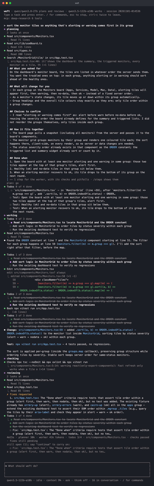
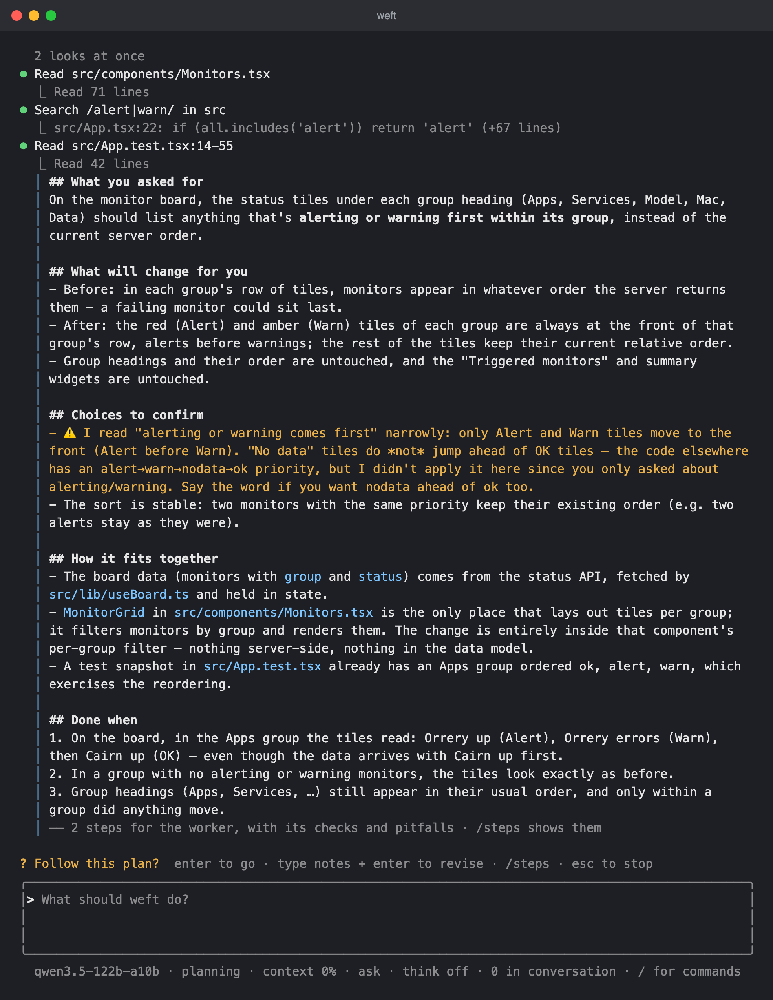

#  Weft

A coding agent for the terminal that runs local models in tandem through
[LM Studio](https://lmstudio.ai). I built it in Rust in order to become better
acquainted with the language.

- **The planner**, a dense model at medium reasoning effort, writes a plan
  in two parts, what will change for you, which you approve, and the steps
  for the worker, and later reviews the diff.
- **The worker**, a fast mixture-of-experts model with thinking off, runs the
  tool loop: reads, searches, edits, runs commands, follows the plan.
- **The scout**, a small model, answers the other two's questions about where
  things live, decides whether a task needs a plan, and writes the note a long
  conversation is folded into.

Built on a Mac Studio with `qwen/qwen3.8-27b` as the planner,
`qwen3.5-122b-a10b` as the worker and `qwen/qwen3.5-9b` as the scout. Any
models LM Studio serves will do.

## In the terminal

Weft draws an input box at the bottom of the terminal and writes the
transcript above it, into the terminal's own scrollback, so it is still there
when you leave. Here it is on a React + Node monitoring board, given "sort the
monitor tiles so anything that's alerting or warning comes first in its
group" (with `/plan`, so it plans whatever the task's size):



Each `⏺` line is a tool call with the first line of its result under it;
looks asked for together run at once. An edit or a new file shows the code
itself, removed lines in red and added lines in green, numbered as they sit
in the file. The plan sits in a cyan gutter, and its steps and the tests its
`Done when` asks for become the checklist, ticked off as the worker goes.
When the worker is done, weft runs the project's checks itself, then the
reviewer reads the diff, looking around the code with read-only tools. Here
the worker's first checklist left out the plan's tests and was refused, so it
put them back and wrote them before the reviewer approved. Edits, new files
and shell commands ask first, and one key answers.

Every plan waits for your word. It opens with what will change for you, in
the app's terms, and any choices to confirm; the worker's file-by-file steps
fold to one line, and `/steps` opens them:



**Keys**

| Key | Does |
|---|---|
| enter | sends the task |
| shift-tab | cycles how much weft asks: ask → edits auto → all auto → plan first |
| ctrl-j, or `\` + enter | a newline |
| ↑ ↓ | history |
| esc | stops the task |
| y / a / n | answers an approval: once, always this session, no |
| ctrl-c twice | leaves |

The input box uses the Emacs keybindings bash and zsh use: ctrl-a and ctrl-e
for the ends of the line, ctrl-k to cut to the end, alt-b and alt-f to move by
a word, and so on.

**Commands** (`/` opens the menu)

| Command | Does |
|---|---|
| `/plan <task>` | plans first and waits for your word on the plan |
| `/go <task>` | straight to work, no plan |
| `/accept` | edits and new files stop asking for the session; shell commands still ask |
| `/undo` | puts back the files the last task changed |
| `/compact` | folds the earlier tasks into a note now |
| `/clear` | starts a fresh conversation |
| `/resume` | lists this folder's earlier sessions; a number, or `/resume 2`, picks one up |
| `/restart` | leaves and comes straight back to this session, on the installed build |
| `/think` | toggles the worker's thinking |
| `/steps` | the worker's steps of the last plan, folded on the screen |
| `/todos` | the worker's checklist; `/todos clear` empties it |
| `/tasks` | this session's tasks and how each ended |
| `/report` | the last task's result card again; `/report 2` for the second |
| `/memory` | what weft has kept about this project |
| `/cost` | tokens used this session |
| `/mcp` | the MCP servers and their tools |
| `/help`, `/quit` | |

## How a task flows

1. **Project note.** Every task opens with a few lines on the folder: its
   path, stack and git state, the file tree three levels deep, your `WEFT.md`,
   and what weft remembered from earlier tasks.
2. **Triage.** The scout's small model (the worker, without one) is asked,
   in one word, whether the task needs a plan. A question or a one-spot change goes straight to work; anything wider
   is planned first. `/plan <task>` and `/go <task>` override it.
3. **Plan.** The planner looks at the code with read-only tools, or asks the
   scout, then writes a plan in two parts. The first is for you, in the app's
   terms with no file names: what you asked for, in your words; what will
   change for you; **choices to confirm**, where it read the request one way
   of several or did something other than what you named (marked ⚠); how
   the pieces fit together; and `## Done when`, what must work as you would
   try it. The second, from `## Steps`, is for the worker: the files and
   changes (naming the helpers nearby code already uses), the command that
   verifies, and the pitfalls. When the change alters an idea the code holds
   in more than one place (which day a week starts on, a unit, a format), the
   plan adds `## Searched for`: the ways the code expresses it and where each
   search found them, so the worker and the reviewer can check none is left
   on the old idea. A plan that skips the first part is asked for
   again, once; out of look-arounds, the planner writes from what it has.
   The screen shows your part and folds the worker's to one line; `/steps`
   opens it.
4. **Work.** The plan's steps become the worker's checklist, shown as it
   goes (`☒` done, `◼` under way, `☐` not started); the status line names the
   step under way and the tool running now. The worker follows the plan with
   the full tool set, runs the check, and reports what changed as `path:line`.
   Each `## Done when` line becomes a `Test:` step: a test that drives it
   through the path the user would take. The worker may rewrite the list,
   but a new list that leaves out an open `Test:` or `Fix:` step is refused.
   If the worker answers with steps still open, it is sent back, up to twice,
   to finish them or say why it cannot.
5. **Checks.** If files were touched and the project has a `verify` command
   (see `[[project]]` below), weft runs it itself. A failure goes back to the
   worker, thinking on, with the end of the output, up to three times.
6. **Tests without the change.** A passing test can still prove nothing, so
   before each review weft copies the project to a temporary folder, puts
   the task's changed code (not its tests) back as it was, and runs the tests
   the task added there. Each should fail. One that passes without the
   change tests something that was already so, and the reviewer is told
   which. Your working tree is never touched. The tests run with the
   `[[project]]`'s `test` command, or one weft guesses: vitest or jest from
   `package.json`, pytest, or `cargo test`. weft also lists every existing
   assertion the task changed or took out, renames aside, so a check moved
   off its edge to make it pass is seen.
7. **Review.** If files were touched, by the edit tools or through `bash`
   (git shows what changed), the planner model reads the diff, the checks'
   result, the run without the change, the changed assertions, the task and
   the plan. It may look past the diff with read-only tools, a few calls, and
   goes through a list: failing checks; a test for each `Done when` line that
   fails without the change; changed assertions the request does not call
   for; new code using the helpers its neighbours use; and anything still
   naming what was removed or working out the old idea by hand. It answers
   `APPROVE` or `FIX`, names the test that covers each `Done when` line, and
   lists its asks, which join the checklist. On `FIX` the worker goes again,
   thinking on, the checks run again, and the reviewer reads the new diff;
   earlier asks it does not make again are ticked off. Two rounds by
   default: one fix pass; asks from the last round wait on the checklist for
   "continue". An answer with no verdict line is asked for again, once, with
   no tools; still none, and the review is called inconclusive: not
   approved, and the worker is not sent after a guess.
8. **Result.** The task ends with a card that says whether the plan is
   complete. It is complete when no step is open, the checks pass, the
   reviewer approved, and every `Done when` line has a test. Each `Done
   when` line shows its test and how it did without the change (`✓` fails
   without it, `⚠` passes anyway, `✗` no test). Under the line come the steps,
   the checks, the review and the time; then anything to look at (a test
   that passes without the change, an existing assertion changed), why it is
   not complete, and the steps still open. The card is green when complete,
   yellow when complete with something to look at, red when not. A task
   that took a minute or more sends a notification with the card's
   headline. `/tasks` lists the session's tasks with theirs, and `/report`
   shows a card again; both come back with `/resume`.

Tasks given one after another share the worker's conversation, so "now do the
same for X" works. A task that reaches its cap of 120 tool rounds ends with
a report of what is done and what is left, and "continue" picks it up. A task that stops early, by esc or by running out of
room, keeps the steps it finished, closed with a line saying why, so the next
task or a resume can carry on from them. The checklist lasts the session (and
comes back with `/resume`): a task that ends with steps open lists them on
its result card, and the next task is shown them, so "continue" picks up at
the first open one.

**Large work runs in rounds.** When the plan spans more than a few files,
the planner adds a `## Tasks` section and the worker does them one at a time.
When a round is done, its reads and edits are folded into a short note and
the next round begins from that, so a big ask no longer piles up in one
window. The review comes once at the end.

**Every plan waits for your word.** Once the plan is on the screen, enter, or
a typed "yes", lets the worker go; "no" or esc stops the task there; anything
else you type is notes, and the planner writes the plan again with them in
mind, up to three times. A line starting with `/` runs as a command (`/steps`,
say) and the plan keeps waiting. A task given as `/go <task>` and the all-auto
mode go straight on, as does `weft run` with no terminal to ask;
`confirm = "never"` in the config goes straight on always.

**Undo.** `/undo` puts back the files the last task changed, and the task
before that on a second `/undo`. Weft's own edits and new files are always
covered. In a git repository, so is whatever a shell command changed: git
keeps a copy of the tracked tree before each task (`git stash create`, which
leaves the tree alone), and undo restores from it and removes files that
appeared. Your own uncommitted edits from before the task survive. The worker
is told on its next task.

**The scout.** Both the planner and the worker have a `scout` tool: one
question about where something lives or how it fits together. A separate
model run searches and reads the project and answers with paths, line numbers
and a few sentences, never file contents. What it read stays in its own
context and is thrown away, so the worker's window holds only the answer. The
models call it themselves; it shows as one `⏺ Scout …` line. A small model
suits it: a 9B answers in 5–15 seconds where the 122B takes 20–30. Small
models sometimes cite a file they never opened, so the paths in every answer
are checked against the folder and the scout is sent back once if one is
missing.

**The delegate.** The worker can hand a self-contained part of a task to a
helper: a fresh worker on the same model, with the same tools and its own
context. The helper's edits and shell commands show on the screen, indented
under the `Delegate` line, and ask for approval like any other; only its
report comes back to the worker that asked, so the files it read stay out of
that context. The reviewer sees the helper's changes too, and an `a` given to
either the worker or a helper holds for both. A helper cannot delegate in
turn.

## Two routes to one server

LM Studio exposes reasoning-effort levels only for models whose template
declares them. The 27B's does, so the planner uses the OpenAI-style
`/v1/chat/completions` route and asks for `low`, `medium` or `xhigh`.

The 122B's template has only an on/off switch, and LM Studio does not expose
it, so the worker uses the raw `/v1/completions` route: weft renders the
prompt in Qwen's chat format itself, starts the assistant turn with an empty
`<think></think>` block, and parses the `<tool_call>` XML the model writes. On
a small task that is the difference between a few hundred and a few thousand
generated tokens.

## Setup

`weft init` writes a starter config, and a `WEFT.md` in the current folder,
where they are missing. At startup weft checks that the configured models are
loaded in LM Studio and says so if one is not. A misspelt key in the config is
an error that names the key, not a silent default. The whole config:

```toml
# ~/.config/weft/config.toml  (chmod 600; it holds the token)
[lm_studio]
url = "http://127.0.0.1:1234"
api_token = "..."            # or set LM_API_TOKEN

[planner]
model = "qwen/qwen3.8-27b"
plan_effort = "medium"      # low | medium | xhigh
review_effort = "low"       # the review is one read of the diff; low is 3x faster than medium
when = "auto"               # auto | always | never
confirm = "asked"           # the plan waits for your word: asked (all but /go) | always | never
review_rounds = 2           # reviews per task, each FIX but the last gets a fix pass; 0 turns review off

[worker]
model = "qwen3.5-122b-a10b"
thinking = false            # the plan carries the reasoning; fix rounds think anyway

[scout]
# model = "qwen/qwen3.5-9b"   # default: the worker's, on the raw route with thinking off
# effort = "low"              # only for a model that honours reasoning_effort

[compact]
at = 48000                  # fold the conversation once the worker's context reaches this; 0 never
window = 65536              # the worker's context window

[vision]
# model = "qwen/qwen3.8-27b"  # the model that looks at images for see_image; default: the planner's
effort = "low"

[approve]                   # tool calls that never ask
# tools = ["edit_file"]
commands = ["cargo test", "cargo build", "git status", "git diff", "git log", "ls"]

[[hooks]]
on = "after_edit"           # after_edit | before_bash | after_task
run = "cargo fmt"           # run with sh -c, in the project root

[[project]]                 # one per folder, matched by path; nothing goes in the repository
path = "~/Code/myapp"
verify = "npx tsc --noEmit && npx vitest run"   # weft runs it after the worker; failures go back
test = "npx vitest run --reporter=verbose {files}"  # runs the new tests without the change; guessed if left out
deploy = "npm run deploy"   # how changes go live; the worker uses it, and "it's live" without it is flagged
serve = "npx vite --port {port} --strictPort"  # a dev server the worker may start to look at a change
app = "http://127.0.0.1:8210"     # the running app, which `live` reads (GET only)
database = ".data/app.sqlite"     # its SQLite file, which `live` queries read-only
verify_timeout_s = 300
notes = """
- Commits are one line.
"""
```

## Project notes and memory

A `WEFT.md` in the project root is read at the start of every task and shown
to the planner, the worker, the reviewer and the scout as your standing
instructions: how the tests are run, what must never be done, how commits are
written. `~/.config/weft/WEFT.md` does the same for every project, and a
`[[project]]`'s `notes` in the config do it for one folder without a file in
its repository. Keep them short; they are in every prompt.

What weft learns on its own goes through its `remember` tool into
`~/.local/share/weft/memory/<folder>.md`, one fact per line: how the tests
run, a convention, a trap it hit. The file is shown after your notes at the
start of every task, in this session and the next. `/memory` prints it, and
you can edit or delete lines as you like.

## Approvals and hooks

Edits, new files, shell commands and MCP tools ask first: `[y] once  [a]
always this session  [n] no`. The terminal's bell rings when a question
comes up, and a macOS notification follows if it is still waiting after 30
seconds; a task that ran a minute or more sends one when it is done. The `[approve]` section of the config names
what never asks: tools by name, and shell commands by their leading words.
`cargo test` lets `cargo test --lib` through and not `cargo testx`; every
part of a chain joined with `&&`, `&`, `;`, `|` or a newline has to match;
and a command with a `$(…)`, a backtick or a `>` in it (`2>&1` aside)
always asks, since a redirect can write over any file. The rules live in your
config, never in the project, so a repository cannot grant itself permissions.

Hooks are shell commands of yours that weft runs at set moments. `after_edit`
runs after every edit or new file with `WEFT_PATH` set, and what it prints
goes to the model with the tool result, so a formatter's changes or a linter's
complaint reach the worker at once. `before_bash` runs before every shell
command with `WEFT_COMMAND` set; a non-zero exit stops the command, and what
the hook printed is the reason the worker sees. `after_task` runs when a task
ends with `WEFT_TOUCHED` listing the files it changed, and its output is shown
on the screen.

## Custom commands

A Markdown file in `.weft/commands/` is a command: `.weft/commands/review.md`
is `/review` in the menu, and the file is the task. `~/.config/weft/commands/`
holds the ones you want in every project; a project file wins on the same
name. Header lines before the first blank line may set a `description` for
the menu and a `mode` (`plan`, `go` or `auto`). `$ARGUMENTS` in the body
stands for whatever follows the command; without it, the arguments are
appended.

```markdown
description: review the working tree before a commit
mode: go

Read `git diff` and list anything a careful reviewer would flag: bugs, missing
tests, naming, and departures from WEFT.md. Do not change files.
```

## MCP servers

Tools from [MCP](https://modelcontextprotocol.io) servers sit beside the
built-in ones. List the servers in `~/.config/weft/mcp.json`, in the same
shape LM Studio and Claude Desktop use, so an entry can be copied across:

```json
{
  "mcpServers": {
    "deep-research": {
      "command": "/opt/homebrew/bin/node",
      "args": ["/path/to/minimal-mcp-deep-research/dist/index.js"]
    }
  }
}
```

`command`, `args`, `env` and `cwd` are understood. Weft starts every server
over stdio when it starts, and the worker sees each tool as `server__tool`,
for instance `deep-research__research`. Every MCP tool asks before it runs. A
server that fails is reported and skipped; `/mcp` and `weft mcp` show what
came up. The planner and reviewer keep to the read-only built-ins.

## Sessions

Everything a session does is written to
`~/.local/share/weft/sessions/<folder>/<id>.jsonl` as it happens: each task,
every message of the worker's conversation, each tool call and result, each
model turn's tokens and seconds, the plans and the reviews. It lives outside
the project, so nothing shows up in `git status` and the worker never stumbles
on its own history. When you leave, weft prints the session's id and the
command that picks it up again.

**Resuming.** `weft resume` reopens the folder's last session and `weft
resume <id>` an earlier one; inside weft, `/resume` lists them and a number
picks one. The screen replays each task with the first line of its answer,
names the tasks compaction folded away, and shows the last plan if there was
one. The worker gets its conversation back,
with a note that the project may have changed and a fresh folder snapshot, and
the file is appended to from there. `/restart` leaves and comes straight back
into the same session on the installed binary, which is how a new build is
picked up without losing your place. Approvals given with `a`, the shift-tab
mode and the undo history belong to the process and start afresh.

**Compaction.** After a task, once the worker's last prompt has reached
`[compact] at`, the earlier tasks are folded into a handover note written by
the scout's model: what was done, which files changed and how, decisions,
loose ends. The last task stays verbatim and the worker carries on from the
note. `/compact` does it on demand. Inside a task, as the window fills, old
tool results and the file text of old edits are dropped first (the disk has
them), and when that is not enough the task's earlier steps are folded into a
progress note and the worker carries on. Both change earlier messages, which
costs a partial re-prefill, so they wait until the window needs it.

## Images

The worker runs on the raw completions route, which carries no images, so
`see_image` sends a picture to a vision model on the chat route and brings
the words back: a description, or the answer to a question about it. Your
models are all vision models; the planner's is used unless `[vision]` names
another. Point the worker at a screenshot in the task text, or drop one on
the terminal, and it will look: `see_image` reads a picture by its full path
wherever it is. A screenshot's name has a narrow space before "PM" that a
model types as a plain one; both spellings are tried. An answer is kept for
the session, so the planner and the worker asking about the same picture
cost one look. macOS keeps iCloud Drive, Desktop and Documents from a
terminal until it is let in (System Settings › Privacy & Security); a
refusal says so.

## Command line

```bash
weft                        # the interface, in the current folder
weft resume [id]            # the interface, continuing the last (or the given) session
weft run "task"             # one task on a plain line printer, then exit (for scripts)
weft run --session last --plan|--go --accept --json "task"   # continue a session; plan or not; edits without asking; JSON lines
weft -y …                   # approve every tool call without asking
weft --think …              # let the worker think before each step
weft sessions               # this folder's sessions
weft tools                  # the worker's tools and what each costs in every prompt
weft init                   # a starter config and WEFT.md, where missing
weft mcp                    # start the MCP servers and list their tools
weft probe                  # ask both models one question; shows each route working
weft tool search '{"pattern":"fn main","glob":"*.rs"}'   # run one tool by hand
```

Every path is resolved against the project root and refused outside it,
symlinks included; the one exception is a picture `see_image` is given by its
full path. `pkill`, `killall` and force pushes are never run, and neither is
anything that stops a process (`kill`) or leaves one running (`&`, `nohup`):
the server on a port is often a service, which stays down once killed. A
project's `deploy` line is how its changes go live.

To look at a change in a browser, the worker has `server`: it runs the
project's `serve` line (or a command it gives, with `{port}` in it) on a free
port weft picks, waits until it answers, and stops the whole process group
when the task ends. `look` saves a screenshot with headless Chrome for
`see_image`; a phone width (under 500px, which headless Chrome won't lay out)
is shot through a frame and cropped with `sips`. Set `CHROME` if Chrome is
not in /Applications.

When a project names its `app` or `database`, the planner, reviewer and
worker get `live`: a GET from the running app (with `pick`, a JSON pointer,
for one part of a large answer) or one SELECT on its database, opened
read-only in sqlite's safe mode. The planner is told to check a reported bug
against it before explaining it from the code, and to say so in the plan when
the app already does what was asked.

## The worker's tools

| Tool | Does |
|---|---|
| `read_file` | numbered lines, up to 200 at a time |
| `list_files` | a folder listing, honouring `.gitignore` |
| `search` | a regex over the project, `path:line: text`, capped at 100 matches |
| `edit_file` | replaces one exact passage, which must match exactly once; reports `path:line` |
| `write_file` | new files only |
| `bash` | runs in the project root with a timeout; last 200 lines of output |
| `scout` | one where-or-how question, answered by a read-only run of another model |
| `delegate` | one self-contained piece of the task, done by a fresh worker that reports back |
| `see_image` | a description of, or an answer about, an image file, from a vision model |
| `remember` | one fact about the project, kept for later tasks and sessions |
| `todo` | the worker's checklist for work of several steps, shown as it goes |
| `server__tool` | any tool of a configured MCP server; asks first |

Looks the model asks for together (reads, listings, searches, pictures) run
side by side; edits, commands and MCP tools run one at a time, in order.

## Reading the code to learn Rust

The comments marked `// Rust:` explain each language feature where it first
appears. In order:

1. **`src/lm/`** — enums with data (`Message`, `StreamEvent`), `String::drain`,
   a struct with a lifetime (`Parser<'a>`), async streaming with channels.
2. **`src/tools/`** — the `Tool` trait, `Box<dyn Tool>`, `#[async_trait]`,
   path handling, `tokio::process` with `join!` on both pipes.
3. **`src/agent/`** — the `Model` trait so tests can script a fake model, the
   worker loop, `tokio::select!` for cancellation, a forwarding task. Then
   `tandem.rs`: the same loop reused for the planner and the reviewer, and the
   verdict parser. `proof.rs`: reading a unified diff, a small tokenizer, a
   copy of the project made with `cp` and removed after. `report.rs`: a
   result built from the rest, serialised into the transcript as an event. `scout.rs` and `delegate.rs`: the loop wrapped up as a
   `Tool` the other models can call, the latter with an `Arc<dyn Approver>`
   carried in through the tool context. `compact.rs`: slicing a conversation
   and rewriting it around a note. `convo.rs`: the one place that writes and
   reads the shape of a task message, with a round-trip test.
4. **`src/mcp.rs`** — a JSON config with `serde`, servers started together with
   `join_all`, a type alias for a long generic, `Arc` sharing one connection
   between its tools, the same `Tool` trait implemented for someone else's tools.
5. **`src/transcript.rs`** — a tagged `serde` enum as a file format, one JSON
   line per record, a `Mutex<File>` writer, folding records back into a
   `Saved` session with `match`.
6. **`src/hooks.rs`**, **`src/commands.rs`**, **`src/checkpoint.rs`** and
   **`src/tools/memory.rs`** — small modules around one idea each: a
   `tokio::process::Command` with a timeout and an environment, a file format
   with a header, a `Mutex` of kept copies that also shells out to `git`, an
   append to a file that stays idempotent.
7. **`src/models.rs`**, **`src/session.rs`** and **`src/ui/`** — one struct
   that turns the config into model handles; the session shared through an
   `Arc` with `Mutex`es held only briefly and an `AtomicU32` read off a
   forwarding task; the screen as a `tokio::select!` loop over key events,
   agent events and a tick, split across `events.rs`, `keys.rs`, `slash.rs`
   and `draw.rs` with `impl` blocks in child modules; ratatui's inline
   viewport with `insert_before` for the transcript; approvals as `oneshot`
   channels; `ui/tests.rs` driving it all through the key handlers with
   ratatui's test backend.
8. **`src/main.rs`** — clap subcommands, `spawn_blocking` for stdin, `exec`
   for `/restart`.

## Development

```bash
cargo test
cargo clippy --all-targets
cargo fmt
```
