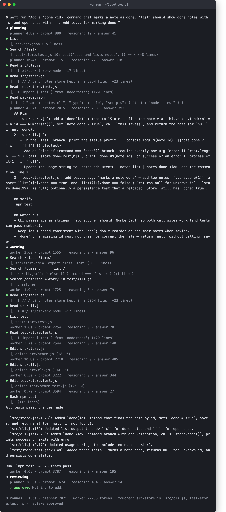
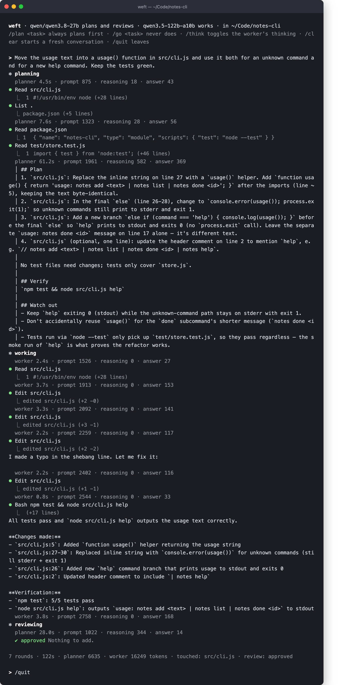

# weft

A coding agent for the terminal that runs two local models in tandem through
[LM Studio](https://lmstudio.ai), in Rust.

- **The planner** (a dense model asked to think hard) writes a short plan and
  later reviews the diff.
- **The worker** (a fast mixture-of-experts model, thinking off) runs the tool
  loop: reads, searches, edits, runs commands, follows the plan.

Built on a Mac Studio with `qwen/qwen3.8-27b` as the planner and
`qwen3.5-122b-a10b` as the worker, but any two models LM Studio serves will do.

## Status

Early but usable. Plan, work and review run end to end; the full-screen UI and
MCP servers are next.

## How a task flows

1. **Triage.** The worker is asked, in one word, whether the task needs a plan.
   A question or a one-spot change goes straight to work; anything wider is
   planned first. `/plan <task>` and `/go <task>` override it.
2. **Plan.** The planner looks at the code with read-only tools (a few searches
   and reads), then writes a short plan: files and changes, the one command
   that verifies, pitfalls it noticed.
3. **Work.** The worker follows the plan with the full tool set, runs the check,
   and reports what changed as `path:line`.
4. **Review.** If files were touched, the planner model reads the diff against
   the task and plan and answers `APPROVE` or `FIX` with a numbered list. On
   `FIX`, the worker goes again, this time with its thinking on. One review
   round by default (`review_rounds` in the config).

Here is a feature added to a small notes CLI. Each `⏺` line is a tool call
with the first line of its result beneath; the dim lines are what each model
turn cost.



Run `weft` on its own in a repository for a session: tasks given one after
another share the worker's conversation, so "now do the same for X" works.



## Two routes to one server

LM Studio exposes reasoning-effort levels only for models whose template
declares them. The 27B has `low / medium / xhigh`, so the planner uses the
OpenAI-style `/v1/chat/completions` route and asks for the level it wants.

The 122B's template has only an on/off switch, and LM Studio does not expose
it, so the worker uses the raw `/v1/completions` route: weft renders the prompt
in Qwen's chat format itself, starts the assistant turn with an empty
`<think></think>` block, and parses the `<tool_call>` XML the model writes.
On a small task that is the difference between a few hundred and a few
thousand generated tokens.

## Setup

```bash
cargo install --path .
mkdir -p ~/.config/weft
cat > ~/.config/weft/config.toml <<'EOF'
[lm_studio]
url = "http://127.0.0.1:1234"
api_token = "..."            # or set LM_API_TOKEN

[planner]
model = "qwen/qwen3.8-27b"
plan_effort = "xhigh"       # low | medium | xhigh
review_effort = "medium"
when = "auto"               # auto | always | never
review_rounds = 1           # 0 turns review off

[worker]
model = "qwen3.5-122b-a10b"
thinking = false            # the planner carries the reasoning; fix rounds think anyway
EOF
chmod 600 ~/.config/weft/config.toml
```

## Commands

```bash
weft                       # a session in the current folder
weft run "task"            # one task, then exit
weft -y …                  # approve every tool call without asking
weft --think …             # let the worker think before each step
weft probe                 # ask both models one question; shows each route working
weft tool search '{"pattern":"fn main","glob":"*.rs"}'   # run one tool by hand
```

In a session: `/plan <task>` always plans first, `/go <task>` never does,
`/think` toggles the worker's thinking, `/clear` starts a fresh conversation,
`/quit` leaves.

Edits, new files and shell commands ask first: `[y] once  [a] always this
session  [n] no`. Ctrl-C stops the current task and keeps the session. Every
path is resolved against the project root and refused outside it, symlinks
included. `pkill`, `killall` and force pushes are never run.

## Tools the worker has

| Tool | What it does |
|---|---|
| `read_file` | Numbered lines, up to 200 at a time |
| `list_files` | Folder listing, honours `.gitignore` |
| `search` | Regex over the project, `path:line: text`, capped at 100 matches |
| `edit_file` | Replace one exact passage; must match exactly once |
| `write_file` | New files only |
| `bash` | Runs in the project root, timeout, last 200 lines of output |

## Reading the code to learn Rust

The comments marked `// Rust:` explain each language feature where it first
appears. In order:

1. **`src/lm/`** — enums with data (`Message`, `StreamEvent`), `String::drain`,
   a struct with a lifetime (`Parser<'a>`), async streaming with channels.
2. **`src/tools/`** — the `Tool` trait, `Box<dyn Tool>`, `#[async_trait]`,
   path handling, `tokio::process` with `join!` on both pipes.
3. **`src/agent/`** — the `Model` trait so tests can script a fake model, the
   worker loop, `tokio::select!` for cancellation, a forwarding task. Then
   `tandem.rs`: the same loop reused for the planner (read-only tools) and the
   reviewer (no tools), and the verdict parser.
4. **`src/main.rs`** — clap subcommands, `spawn_blocking` for stdin, generics
   over a closure that returns a future.

## Development

```bash
cargo test
cargo clippy --all-targets
cargo fmt
```
